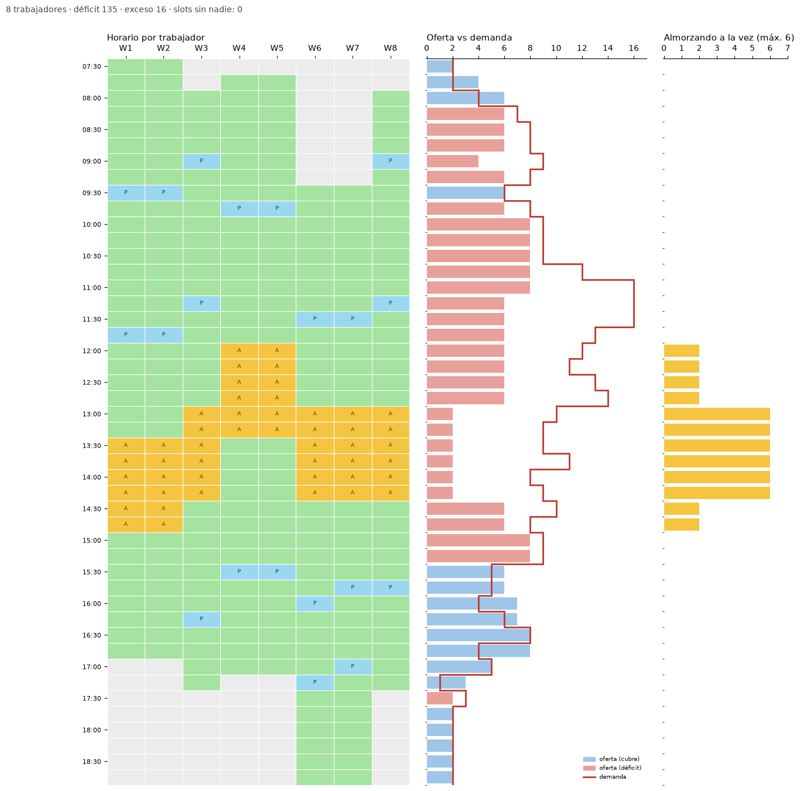
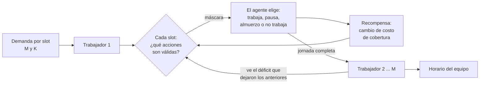

# Horarios de trabajo con Aprendizaje por Refuerzo

Agente de aprendizaje por refuerzo que construye el horario diario de **M trabajadores** de retail, en franjas de 15 minutos, cumpliendo reglas de negocio y ajustando la plantilla a la demanda de cada franja.

Está hecho con [Gymnasium](https://gymnasium.farama.org/) y `MaskablePPO` de [sb3-contrib](https://sb3-contrib.readthedocs.io/).



*Ejemplo con 8 trabajadores. Izquierda: horario de cada trabajador. Centro: oferta contra demanda. Derecha: trabajadores almorzando en cada franja.*

## Qué hace

- Genera, para cada trabajador, una jornada completa (trabajo, pausas activas y almuerzo) que **siempre cumple las reglas**: una máscara de acciones con backtracking impide que el agente tome decisiones que luego no se puedan completar.
- Minimiza un costo de cobertura: penaliza más la falta de personal que el exceso.
- Permite limitar cuántos trabajadores almuerzan a la vez.
- Funciona con cualquier número de trabajadores, entrenando un modelo para cada uno (ver [Limitaciones](#limitaciones)).

## El problema

El día tiene **46 franjas de 15 minutos** (07:30 a 18:45). En cada franja el agente elige una de cuatro acciones:

| Acción | Significado | Franjas que ocupa |
|---|---|---|
| 0 | No trabaja | 1 |
| 1 | Pausa activa | 1 |
| 2 | Almuerzo | 6 (1 h 30) |
| 3 | Trabaja | 1 |

Reglas de negocio:

| Regla | Descripción |
|---|---|
| R1 | Mínimo 4 franjas (1 h) de trabajo continuo antes de una pausa o del almuerzo |
| R2 | Máximo 8 franjas (2 h) de trabajo continuo sin pausa |
| R3 | La jornada son 32 franjas de `Trabaja` + `Pausa`. El almuerzo (6 franjas) no cuenta en la jornada |
| R4 | `No trabaja` solo al inicio o al final de la jornada |
| R5 | El último estado activo debe ser `Trabaja` |
| R6 | Al menos un trabajador activo en cada franja. **Hoy solo se verifica** en `validar_multi`; el entorno no lo exige |
| Almuerzo | Debe empezar entre las 11:30 y las 13:30 |
| Descanso realista | Después de una pausa o un almuerzo deben quedar al menos 4 franjas de jornada por trabajar (`MIN_TRABAJO_TRAS_DESCANSO`) |
| Tope de almuerzos (opcional) | Nunca más de `K` trabajadores almorzando a la vez (`max_almorzando`) |

**Objetivo:** minimizar el costo de cobertura, que suma por franja `1.5 × déficit` (oferta menor que demanda) o `0.5 × exceso` (oferta mayor que demanda).

## Cómo funciona



**Construcción secuencial.** El agente arma el horario del trabajador 1 completo, luego el del 2, y así hasta el M. Un episodio dura M × 41 decisiones: cada trabajador necesita 41 (las 46 franjas, ya que el almuerzo ocupa 6 en una sola decisión).

**Máscara con backtracking.** En cada franja solo se ofrecen acciones que respetan las reglas **y** desde las cuales todavía se puede terminar el horario. Para saberlo, `_factible(estado)` hace una búsqueda en profundidad con memoización (`lru_cache`): cada estado se calcula una sola vez. Esto resolvió el problema inicial: con una política aleatoria que solo comprobaba las reglas de la franja actual, alrededor del 45 % de los horarios de un trabajador terminaban incumpliendo alguna regla (por ejemplo, sin almuerzo). Con la máscara con backtracking, el 100 % es válido.

**Tope de almuerzos simultáneos.** Como los trabajadores se construyen uno a uno, para el actual ya se conoce cuántos almuerzos hay en cada franja. Un inicio de almuerzo se permite solo si no supera `K` en ninguna de sus 6 franjas y, además, los trabajadores que faltan todavía pueden colocar el suyo (`_colocables`, otro backtracking). Sin esa segunda condición, los últimos trabajadores podrían quedarse sin hueco.

**Observación.** Todo escalado a rangos pequeños: franja actual, horario en construcción, horarios de los trabajadores ya terminados (matriz M × 46), jornada y almuerzo restantes, demanda, **déficit por franja** (demanda − oferta de los ya terminados) y el déficit de cada posible ventana de almuerzo.

**Recompensa.** Cada `Trabaja` recibe el cambio real de costo de cobertura de su franja, según la oferta que ya dejaron los trabajadores anteriores. La suma de esos premios es igual a la penalización de cobertura del día completo, repartida paso a paso en lugar de llegar al final. El almuerzo se castiga según la cobertura que se pierde en sus 6 franjas (`PESO_ALMUERZO`). Hay además pequeños premios y castigos por pausas, tiempos muertos y reglas rotas, y un bono de +30 por cada trabajador que cumple todo.

**Entrenamiento.** `MaskablePPO` con `gamma=1.0`, `ent_coef=0.01` y una red de 256×256 neuronas tanto para la política como para el crítico.

## Resultados

Demanda real de una tienda, 8 trabajadores, 400 000 pasos, una semilla por fila (el costo es el de cobertura definido arriba; menor es mejor):

| Versión | Costo |
|---|---|
| Entorno original (`gamma=0.99`, observación sin escalar, red 64×64) | 240 a 260 |
| + `gamma=1.0` y recompensa densa | ≈ 236 |
| + observación escalada, red 256×256 y castigo de cobertura en el almuerzo | ≈ 210 |
| + tope de almuerzos `K=5` | 212.5 |
| + regla de trabajo mínimo tras descanso (dos semillas) | 213.5 y 221.5 |
| Referencia (búsqueda aparte, mismas reglas) | ≈ 204.5 |

El mayor salto vino de escalar la observación y agrandar la red, no de la recompensa.

Con otros números de trabajadores (versión previa al tope `K` y a la regla de descanso):

| M | Pasos | Costo del agente | Referencia |
|---|---|---|---|
| 5 | 250 000 | 318 | 309 |
| 12 | 600 000 | 147 | 129.5 |

**Cómo se mide la calidad.** La referencia enumera todos los horarios válidos de un trabajador (6 132 con las reglas actuales) y mejora el horario de cada trabajador por turnos, con reinicios aleatorios. Es una buena referencia, pero **no está demostrada como óptima**, y no incluye el tope de almuerzos.

Los costos de configuraciones con reglas distintas no son estrictamente comparables, porque cada regla restringe más el problema. Con una sola semilla, diferencias de 5 a 10 puntos están dentro del ruido.

## Instalación

Probado con Python 3.13 y estas versiones:

```
gymnasium 1.4.0 · numpy 2.5.3 · pandas 3.0.5 · matplotlib 3.11.2
torch 2.15.0 · stable-baselines3 2.9.2 · sb3-contrib 2.9.2
```

```bash
git clone <url-del-repositorio>
cd <carpeta>
python -m venv env
source env/bin/activate        # en Windows: env\Scripts\activate
pip install -r requirements.txt
```

## Uso rápido

**1. Datos.** Un CSV con separador `;`, encabezado y una fila por franja (46 filas): fecha y hora, y demanda.

```
fecha_hora;demanda
2026-01-05 07:30;2
2026-01-05 07:45;2
...
```

**2. Entrenar.**

```python
import os
from sb3_contrib import MaskablePPO
from sb3_contrib.common.wrappers import ActionMasker
from entorno import *

DEMANDA = cargar_demanda("Datos/Demanda.csv")
M, K = 8, None                       # K = máximo de almuerzos simultáneos; None desactiva el tope
print("K mínimo posible para", M, "trabajadores:", k_minimo(M))

def make_env():
    return ActionMasker(HorarioMultiEnv(num_trabajadores=M, demanda=DEMANDA,
                                        max_almorzando=K), mask_fn)

model = MaskablePPO("MultiInputPolicy", make_env(), verbose=1,
                    n_steps=2048, batch_size=256, n_epochs=10, learning_rate=3e-4,
                    gamma=1.0, ent_coef=0.01, seed=0,
                    policy_kwargs=dict(net_arch=dict(pi=[256, 256], vf=[256, 256])))
model.learn(total_timesteps=50_000 * M)     # unos 9 minutos con 8 trabajadores en 2 CPU
os.makedirs("Pesos", exist_ok=True)
model.save("Pesos/modelo_W8_KNone")
```

**3. Generar y validar un horario.**

```python
model = MaskablePPO.load("Pesos/modelo_W8_KNone")
env = generar_horario(model, M, DEMANDA, max_almorzando=K)   # el mismo K del entrenamiento

validar_multi(env.horarios, DEMANDA)         # reglas por trabajador y cobertura
print("Costo de cobertura:", env.costo_cobertura())
```

**4. Visualizar.**

```python
import os
from visualizar import mostrar_horario

os.makedirs("docs", exist_ok=True)
mostrar_horario(env.horarios, DEMANDA, K=K, guardar="docs/ejemplo_horario.png")
```

## Parámetros

| Parámetro | Dónde | Qué hace |
|---|---|---|
| `num_trabajadores` | `HorarioMultiEnv(...)` | Número de trabajadores M |
| `demanda` | `HorarioMultiEnv(...)` | Vector de 46 valores. `None` genera una demanda aleatoria en cada episodio |
| `max_almorzando` | `HorarioMultiEnv(...)` | Tope K de almuerzos simultáneos. `None` lo desactiva |
| `MIN_TRABAJO_TRAS_DESCANSO` | constante en `entorno.py` | Franjas de trabajo mínimas tras una pausa o un almuerzo. `0` desactiva la regla |
| `PESO_ALMUERZO` | constante en `entorno.py` | Peso del castigo por la cobertura que se pierde durante el almuerzo |

Si cambias las constantes, reinicia el kernel: las funciones con caché guardan resultados calculados con el valor anterior.

**Qué valor de K elegir.** Los almuerzos duran 6 franjas y todos empiezan entre las 11:30 y las 13:30, así que caben en 14 franjas. Eso fija un K mínimo posible. `k_minimo(M)` lo calcula; con `K` menor a ese valor el entorno lanza un error.

| M | 3 | 5 | 8 | 10 | 12 | 16 |
|---|---|---|---|---|---|---|
| K mínimo | 2 | 3 | 4 | 5 | 6 | 8 |

Con 8 trabajadores, `K=4` es el reparto más parejo posible y `K=5` deja algo más de margen al agente.

## Cambiar el número de trabajadores

Un modelo está atado al M con el que se entrenó: la observación incluye una matriz M × 46, y un modelo de 8 trabajadores no se puede usar con 9 (da un error de forma). Para otro M hay que entrenar uno nuevo, con el mismo código cambiando `M`. Como punto de partida, usa unos 50 000 pasos por trabajador; solo lo he probado hasta M = 12.

## Limitaciones

- **Un modelo por número de trabajadores y por demanda.** Con una demanda distinta a la del entrenamiento, los horarios siguen siendo válidos (las reglas viven en la máscara), pero la calidad baja: en pruebas con curvas distintas, el costo quedó entre 8 % y 31 % por encima de la referencia, frente a 4 % con la demanda de entrenamiento.
- **R6 no se exige.** En algunas corridas quedan franjas sin ningún trabajador, normalmente al final del día.
- **Las pausas pueden coincidir** entre varios trabajadores. Hoy no hay un tope para eso.
- **No se garantiza el óptimo.** La referencia es una búsqueda heurística.
- Los resultados son de una o dos semillas por configuración.

## Ideas para seguir

- Exigir R6 en el entorno.
- Limitar las pausas simultáneas, con la misma técnica que el tope de almuerzos.
- Un único modelo que sirva para cualquier M y demanda: un prototipo, entrenado con M y demandas sintéticas variables, dio horarios siempre válidos con una brecha media de alrededor de 13 % sobre la referencia en casos no vistos. Falta mejorarlo y no está incluido en este repositorio.
- Más semillas por configuración para separar mejoras reales del ruido.

## Estructura del repositorio

```
.
├── README.md
├── requirements.txt
├── entorno.py          # entorno, reglas, backtracking, validador y utilidades
├── visualizar.py       # gráfico del horario
├── main.ipynb          # notebook de entrenamiento y evaluación
├── Datos/
│   └── Demanda.csv     # demanda por franja (formato descrito arriba)
├── Pesos/              # modelos entrenados (.zip de stable-baselines3)
└── docs/
    └── ejemplo_horario.png
```

Los modelos de `Pesos/` solo sirven con el mismo número de trabajadores, la misma demanda y el mismo `K` con los que se entrenaron. El nombre del archivo debería indicarlos (por ejemplo `modelo_W8_K5`).


